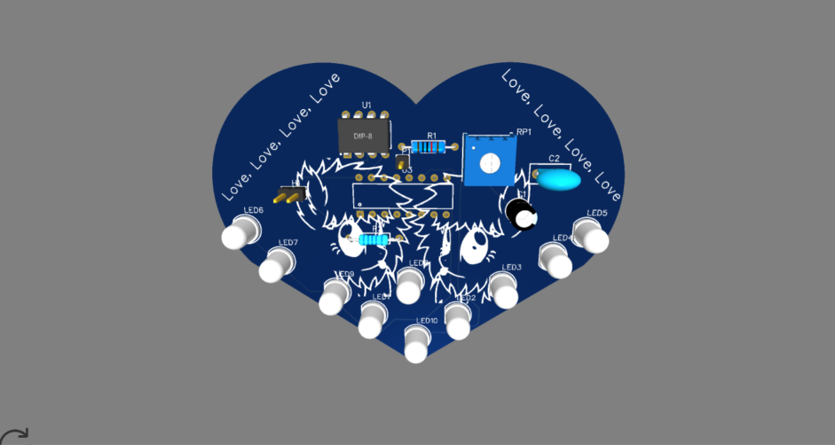
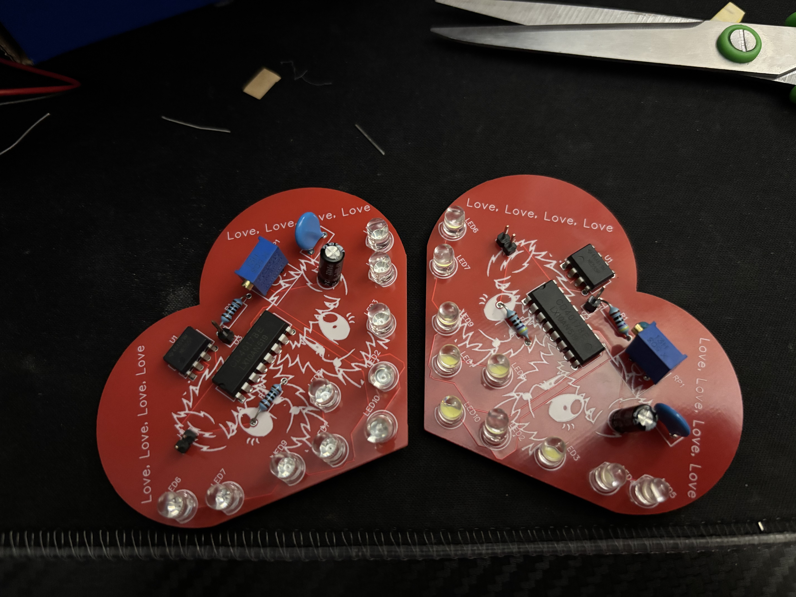

# blink-blink-blink

## About

This is a PCB created following the Blueprint LED Chaser guide. This PCB is a red, heart shaped PCB with Fluffle Puff on it!!

## Final Build

I finally completed the PCB build today almost a year after I designed it. I didn't complete it initially because the sponge for the soldering iron wasn't there, so I didn't want to risk having a bad solder joint because the iron wasn't clean. However, I decided recently to go ahead with building it despite the fact I didn't have a sponge. 

I did two PCBs because the kit included enough to do so. One has red LEDs and the other has white LEDs. I had no issues with continuity either, but I had to supply the power source myself (thank God I still had a battery from a project last year!). 

Here is the photo of the PCBs.

